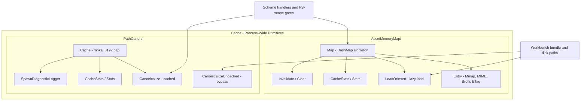
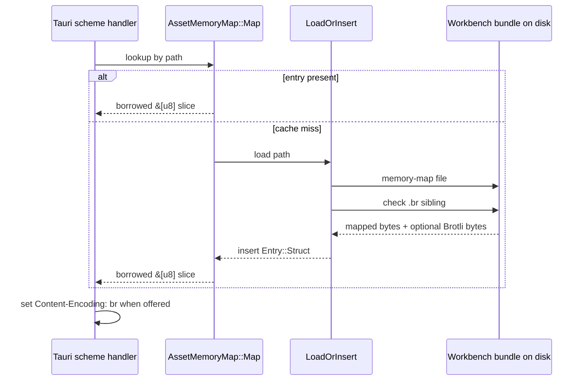
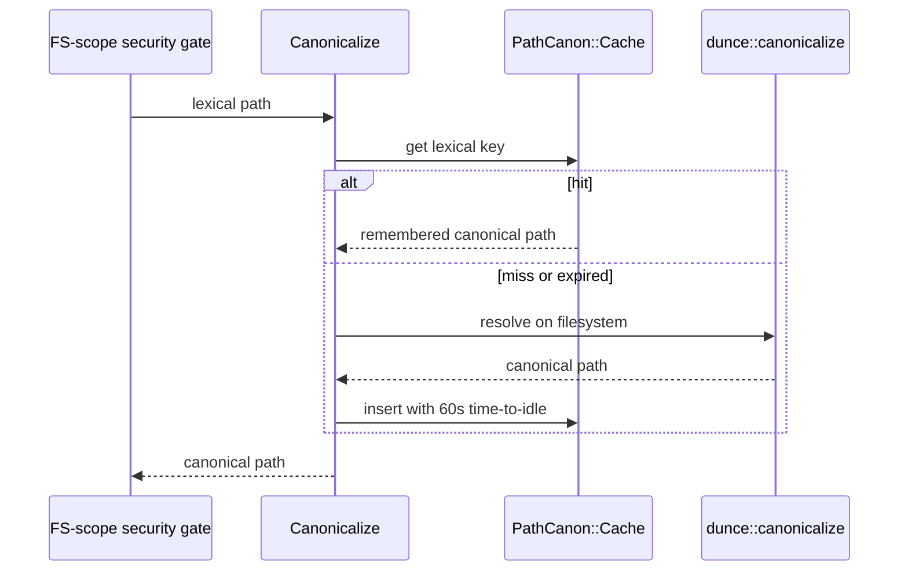

<table>
	<tr>
		<td colspan="1">
			<h3 align="center">
				<picture>
					<source media="(prefers-color-scheme: dark)" srcset="https://editor.land/Dark/Image/GitHub/Land.svg">
					<source media="(prefers-color-scheme: light)" srcset="https://editor.land/Image/GitHub/Land.svg">
					
				</picture>
			</h3>
		</td>
		<td colspan="3" valign="top"><h3 align="center">Cache</h3></td>
	</tr>
</table>

---

# Cache Architecture

`Cache` is the process-wide caching crate for `Land`. It exposes two independent caches that any embedder can use:

- `AssetMemoryMap` - zero-copy, memory-mapped access to bundled static assets
- `PathCanon` - a bounded canonical-path lookup store for file-system security gates

The crate is declared in [`Cargo.toml`](https://github.com/CodeEditorLand/Cache/tree/Current/Cargo.toml) with a single library target named `Cache` rooted at [`Source/Library.rs`](https://github.com/CodeEditorLand/Cache/tree/Current/Source/Library.rs).

---

## Table of Contents 📖

1. [Overview](#overview)
2. [Architecture](#architecture)
3. [Module Map](#module-map)
4. [Data Flow](#data-flow)
5. [Configuration](#configuration)
6. [In the Land Project](#in-the-land-project)
7. [Related Documentation](#related-documentation)
8. [Shim Compatibility](#shim-compatibility)

---

## Overview 📋

`Cache` remembers work the editor has already done so it is not repeated. Both caches are additive acceleration layers:

| Attribute | Value |
| -------- | -------- |
| Language | `Rust` (edition 2024) |
| Crate type | Library (`Cache`) |
| Entry point | `Source/Library.rs` |
| Caching backends | `memmap2` + `DashMap` for assets; `moka` for paths |
| Consumers | `Mountain`, `Wind`, `Maintain`, any `Land` embedder |

Two facts decide how the rest of this document is organised:

- The two caches are independent; disabling either one leaves behaviour correct, only slower.
- Each cache is a directory of single-purpose files, declared as modules in `Source/Library.rs`.

---

## Architecture 🏗️

`AssetMemoryMap` avoids the read-copy-allocate cycle for static files:

- The bundled workbench under `Sky/Target/Static/Application/` is roughly `80 MB` of `.js`, `.css`, `.svg` and font assets.
- A per-request `fs::read` pays a syscall, an allocation and a full copy; `memmap2::Mmap` hands the webview a borrowed slice of file-backed pages.
- The operating system can evict those pages under memory pressure.
- An optional `<file>.br` sibling is loaded alongside the original file.
- Scheme handlers for `vscode-file://`, `tauri://` and `land://` serve the pre-compressed bytes with `Content-Encoding: br` when the client offers it.
- `DashMap` shards give wait-free reads; first-load races on one shard lock.
- The asset cache has no eviction today because the bundle is bounded.

`PathCanon` collapses repeated path resolution:

- Keys are lexical `PathBuf` values; values are the result of `dunce::canonicalize`.
- A hit skips the syscall; a miss runs the resolver and stores the answer.
- `time_to_idle` is `60` seconds and resets on every access, so hot paths stay cached and one-shot paths age out.
- The bound limits staleness after an external rename.

| Cache | Backing store | Capacity | Freshness rule |
| -------- | -------- | -------- | -------- |
| `AssetMemoryMap` | `DashMap<PathBuf, Arc<Entry::Struct>>` | bounded by the `~80 MB` bundle | no eviction; manual `Invalidate` / `Clear` |
| `PathCanon` | `moka::sync::Cache<PathBuf, PathBuf>` | `8 192` entries | `time_to_idle = 60s` |

---

## Module Map 🗺️

Every path below exists in the source tree. Links point to the canonical location on the `Current` branch.

| Path | Purpose |
| -------- | -------- |
| `Source/Library.rs` | Crate root; declares `AssetMemoryMap` and `PathCanon` |
| `Source/AssetMemoryMap.rs` | Module root: file-backed memory-mapped asset cache |
| `Source/AssetMemoryMap/Map.rs` | Process-global `DashMap` behind `OnceLock` |
| `Source/AssetMemoryMap/Entry.rs` | Per-asset `Mmap`, MIME, length, optional Brotli `Mmap`, weak `ETag` |
| `Source/AssetMemoryMap/LoadOrInsert.rs` | Lazy `Mmap` creation with `.br` sibling detection |
| `Source/AssetMemoryMap/CacheStats.rs` | Occupancy snapshot: entries, Brotli entries, bytes, Brotli bytes |
| `Source/AssetMemoryMap/Stats.rs` | Aggregated statistics |
| `Source/AssetMemoryMap/Invalidate.rs` | Per-entry eviction from the asset cache |
| `Source/AssetMemoryMap/Clear.rs` | Full asset cache reset |
| `Source/AssetMemoryMap/MimeFromExtension.rs` | Extension-to-MIME lookup |
| `Source/PathCanon.rs` | Module root: canonical-path cache |
| `Source/PathCanon/Cache.rs` | `Lazy<moka::sync::Cache>` with `8 192` capacity and `60s` idle eviction |
| `Source/PathCanon/Canonicalize.rs` | Cached `dunce::canonicalize`; checks the store first |
| `Source/PathCanon/CanonicalizeUncached.rs` | Bypass-cache resolution for a fresh answer |
| `Source/PathCanon/CacheStats.rs` | Path cache statistics |
| `Source/PathCanon/Stats.rs` | Hit/miss/capacity reporting |
| `Source/PathCanon/Invalidate.rs` | Per-path eviction |
| `Source/PathCanon/Clear.rs` | Full path cache reset |
| `Source/PathCanon/SpawnDiagnosticLogger.rs` | Periodic telemetry emission for cache statistics |

---

## Data Flow 📊

### Asset Serving Flow

### Path Resolution Flow

---

## Configuration ⚙️

`Cache` has no environment variables. Its behaviour is fixed in source:

| Setting | Value | Source file |
| -------- | -------- | -------- |
| Path cache capacity | `8 192` entries | `Source/PathCanon/Cache.rs` |
| Path cache idle expiry | `60` seconds | `Source/PathCanon/Cache.rs` |
| Diagnostic logger | spawned by `SpawnDiagnosticLogger` | `Source/PathCanon/SpawnDiagnosticLogger.rs` |
| Brotli sibling source | `Maintain/Build/Brotli/Pre-Bake.ts` | `Source/AssetMemoryMap/LoadOrInsert.rs` |
| Asset cache eviction | none; manual `Invalidate` / `Clear` | `Source/AssetMemoryMap/` |

---

## In the Land Project 🔌

`Cache` is used on hot paths only:

| Consumer | Cache used | Pattern |
| -------- | -------- | -------- |
| `Mountain` | `AssetMemoryMap` | Scheme handler asset serving to `Sky` / `Wind` WebView |
| `Mountain` | `PathCanon` | FS-scope gates for extension paths, git scopes and file imports |
| `Wind` | `AssetMemoryMap` | Zero-copy response bodies for `application/javascript` |
| `Maintain` | `AssetMemoryMap` | Brotli sibling pre-bake consumed by `LoadOrInsert` |

During a typical startup, path caching saves roughly `150 ms`:

| Path class | Approximate count |
| -------- | -------- |
| Extension manifest paths | `~113` |
| Chunked workbench `JavaScript` imports | `~80` |
| Git extension scope checks | `~60` |

---

## Related Documentation 📖

- [README](https://github.com/CodeEditorLand/Cache/tree/Current/README.md) - product overview and usage examples
- [Mountain](https://github.com/CodeEditorLand/Mountain/tree/Current/Documentation/GitHub/Architecture.md) - primary consumer
- [Wind](https://github.com/CodeEditorLand/Wind/tree/Current/Documentation/GitHub/Architecture.md) - zero-copy response consumer
- [Maintain](https://github.com/CodeEditorLand/Maintain/tree/Current/Documentation/GitHub/Architecture.md) - Brotli sibling pre-bake
- [BuildPipeline](https://github.com/CodeEditorLand/Land/tree/Current/Documentation/GitHub/BuildPipeline.md) - build pipeline

---

## Shim Compatibility 🛡️

| 🟠 Low-Level Shim | 🔵 Coverage Shim |
| -------- | -------- |
| Tier: `TierShim=Own\|Preempt` | Tier: `TierShim=Proxy\|Replace` |
| Engine prototype hooks | Service routing + audit |

> This Element supports the `Land` deep-shim interception system. Gated behind the `TierShim` environment variable (default: `None` - zero overhead).
>
> **Cache shim modules:** none - the crate is a library consumed through `Mountain` and `Wind`.

---

**Project Maintainers:** Source Open
([Source/Open@Editor.Land](mailto:Source/Open@Editor.Land)) |
[GitHub Repository](https://github.com/CodeEditorLand/Cache) |
[Report an Issue](https://github.com/CodeEditorLand/Cache/issues)
